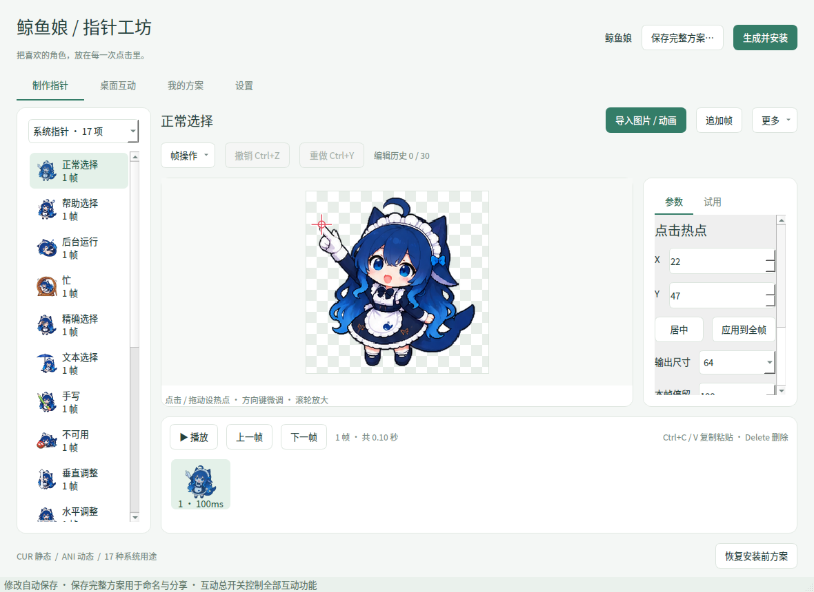
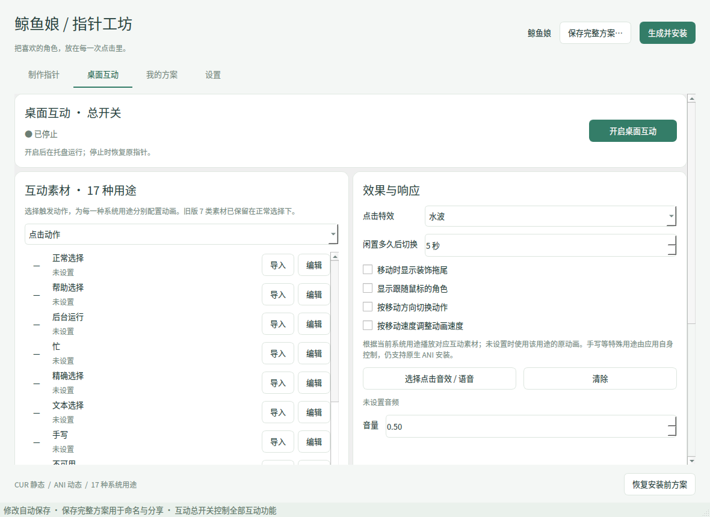

# 鲸鱼娘 · 指针工坊

一个简洁的 Windows 鼠标指针制作工具。导入图片或动画、点选热点、预览并安装；附带可选的桌面互动模式。

## 2.6 更新

- 在任务栏及系统任务栏缩略图显示期间，临时交还系统原生指针，避免普通桌面绘制层被系统预览盖住；离开后恢复互动指针。此时使用开启互动前已安装的系统指针方案，条件动画会在回到普通桌面后恢复。
- “AI 生图 → 生成与回传”新增 API 设置、参考图和返回预览。支持 OpenAI 兼容 Images 接口，可配置 Base URL、模型和请求尺寸；Key 只在本次运行中使用，既不落盘，也不进入完整方案。
- 添加图片或使用制作页当前帧作为参考；点击发送后，每个勾选用途各发一次请求。无参考图发 `/images/generations` JSON；有参考图发 `/images/edits` multipart `image[]`。此结构可通过 `OpenAIImagesAdapter` 扩展其他服务协议，不表示兼容所有平台。
- 返回支持 `data[0].b64_json` 或 HTTPS 图片 URL；下载返回图不携带 API Key，跨地址重定向不会自动跟随。生成请求不自动重试；取消会停止后续请求，已提交请求仍可能计费。未填写有效 Key 前不发请求。
- 选择返回结果，点“覆盖对应帧”替换发送时绑定的那一组素材，按行列拆帧并应用发送时热点和时长，支持统一撤销。不会因后来点击别的用途而覆盖错组；切换或撤销导致方案改变后需保存图片手动导入。
- API 请求尺寸须满足服务商限制，同时让返回图可被指定行列整除且每格为正方形。否则可预览、保存，不能直接覆盖；原素材保留。AI 的帧序、热点与透明背景仍需人工检查。
- 参考图限制 8 张 / 合计 32 MB，返回图最大 1600 万像素；返回原图缓存于用户目录 `ai-results`，界面使用缩略图。可以另存 PNG 后在制作页手动导入。

接口格式参考：[OpenAI Images 编辑接口](https://developers.openai.com/api/reference/resources/images/methods/edit)。模型 ID 与可用尺寸以你所用服务的文档为准。程序与 ChatGPT 订阅独立，不会读取浏览器账号或代填密钥。

## 2.5 更新

- 透明绘制每次明确清空背景；特效结束后保留已清空的透明绘制层，避免连续点击反复隐藏 / 显示窗口引起闪烁；空闲时不反复重绘。
- 应用方案首次读取与解码放到后台，切换立即清理旧特效；加载中仍可操作，不阻塞桌面动画。已读取方案缓存复用，过期加载结果不会切回错误应用。
- 指针层在每帧恢复非激活置顶顺序，避免下拉列表或菜单弹出后遮挡指针；主界面不置顶。
- 新增“AI 生图”页：多选系统指针、各互动动作的各用途、装饰和条件动画；双击帧数单独调整，统一设置单帧尺寸和每行帧数，填写画风后一键复制。
- 提示文本包含用途、帧数、格尺寸、序列图尺寸与排布、每帧热点和时长、透明背景与锚点要求。选择和参数随完整方案保存；本页不调用在线 AI，不修改图片。生成后的热点需人工核对，生成器的尺寸限制可能需要分批生图。

## 2.4 更新

- 修复点击特效引起的抖动：指针和装饰使用独立绘制窗口，特效按完整运动范围预留固定区域，指针窗口不随帧热点或特效缩放反复改变尺寸；布局和绘制使用同一帧时钟。

- 桌面互动改为从方案的原图帧直接绘制，保留每帧热点和时长；不再把动画帧反复送入系统指针替换接口，避免系统内部缩小后再放大。开启像素缩放时使用最近邻采样。
- 互动运行时不再导出或加载多尺寸 ANI。系统指针全部替换成动画后，以及匹配 `msedge.exe` 等应用切换方案时，都直接读取帧播放，不依赖 Windows ANI 加载器。CUR / ANI 的导出安装功能仍独立保留。
- 桌面绘制窗口独立于主界面，只覆盖当前绘制区域，不使用全桌面窗口。主界面不随特效置顶；最小化到任务栏后互动也继续运行。
- 点击素材可使用渐隐、上浮、飘落、旋转、弹出、环绕、散射，支持 JSON 自定义关键帧、示例、参数提示和试播。
- 制作页左侧新增“清空非系统动画”，默认取消，确认后只清空当前方案的互动、条件、点击、拖尾、角色动画素材。系统指针、音效、条件设置保留；支持撤销。运行中的互动会先停止。

### 点击特效制作

1. 在“制作指针 → 装饰效果 → 点击特效”导入图片、GIF / WebP、ANI 或帧序列，编辑帧顺序和停留时间。
2. 到“桌面互动 → 效果 → 点击”，选择点击特效“自定义”，再选运动方式、大小、持续时间和透明度。
3. 点“试播”可直接查看当前配置，无需开启桌面互动。修改运行中的设置后，停止并重新开启互动生效。
4. “关键帧 / 提示”内可填入示例。JSON 关键帧首帧 `t=0`、末帧 `t=1`；`x/y` 为相对点击位置的像素偏移（右下为正），`scale` 为倍率、`rotation` 为角度、`opacity` 为 0～1 的透明度。帧间自动插值，播放速度由持续时间控制。

```json
[
  {"t": 0, "scale": 0.3, "rotation": -25, "opacity": 1},
  {"t": 0.3, "y": -25, "scale": 1.3, "rotation": 15, "opacity": 1},
  {"t": 1, "x": 15, "y": -90, "scale": 0.8, "rotation": 70, "opacity": 0}
]
```

互动采用桌面绘制，因此需保持程序运行。未配置素材或无法识别的应用自绘指针会保留其正常显示；关闭互动、退出或异常恢复时重新载入原系统方案。全屏游戏、安全桌面和部分自绘指针程序仍不支持覆盖。

## 2.3 更新

- 互动页新增“条件动画”：主触发、按键、移动方向和系统指针状态可以组合。条件越具体越优先，同样具体按列表顺序，规则可拖动排序；触发项顺序也能调整。
- 左右中键独立计时。规则可勾选“保持到对应按键松开”：保持期间仅在同一触发项、同一按键内匹配，松键后按剩余状态重新选择，最后回到当前系统指针。不会倒放旧状态，也不会把右键长按继承给左键。
- 瞬间点击特效与音效独立于主指针动画，长按或拖动期间也能响应其他按键的点击。
- 互动帧按当前屏幕缩放比例直接从 256px 原图生成；基础指针提供多尺寸图像，避免只提供低分辨率图片后再放大。像素缩放选项保持生效。
- 点击、拖尾、角色、响应分别分组，各自的大小、透明度、时长和偏移集中排列。
- 音效可选随机或顺序循环，列表支持拖动排序；不同触发分别记录播放进度，重新开启互动从第一段开始。
- 既有方案的动作仍保留在“已有动画”，没有匹配的新条件规则时可继续使用。

### 配置示例

在“条件动画”点“添加”，选择触发“长按”、按键“右键”，移动和指针不限，勾选保持到松键，导入通用动画。再添加“右键长按 + 移动”“右键长按 + 文本”等变体。程序先选择触发，再匹配更具体的变体；右键松开后立即重新判断左键等仍成立的条件。

“点击 + 左键 + 向左”使用点击时最近的方向；“长按 + 向左”则要求仍在向左移动。停止移动有短暂缓冲，避免方向抖动导致反复切换。长按判定为 0.5 秒。主指针一次只播放一个动画，点击装饰、跟随角色和音效可独立共存。

## 2.2 更新

- 自动保存在后台处理，减少重复缩放与图片转换，隐藏的动画预览停止计时。
- 制作页采用紧凑参数布局，x / y 同行，尺寸 / 停留同行；输入控件不接受滚轮修改。预览支持中键拖拽、滚轮缩放，热点坐标随平移正确换算。
- 居中、应用全帧、还原和仅安装放在预览上方。左侧清空当前列表，帧条清空当前动画，均可撤销。
- 互动默认共用一个动画，也可按当前系统指针状态分别配置。旧方案保留原来的按状态配置方式。
- 点击特效、拖尾、跟随角色可以导入 PNG / GIF / WebP / ANI 或帧序列，在制作页的“装饰效果”中编辑，互动页调整大小、透明度、持续时间、间距与跟随偏移。点击特效选择“自定义”后使用导入动画；拖尾和跟随角色分别勾选开启。
- 音效可以绑定不同触发，支持多段 PCM WAV 随机播放；无需同时配置指针动画。连续动作仅在进入状态时播放音效，避免每帧重复播放。
- 设置页可以修改快捷键和撤销次数（默认 30，允许 1～200）。图片、帧、热点、效果和音频会随完整方案保存。

## 打开就用

从 [Windows 便携版](https://github.com/poiakl/whale-cursor-studio/releases/tag/desktop-latest) 下载 `WhaleCursorStudio-Windows.zip`，**完整解压后双击 `WhaleCursorStudio.exe`**。不需要安装 Python，不需要管理员权限。

便携版面向 Windows 10 / 11 x64。原生 CUR / ANI 安装后可以完全退出工具；桌面互动开启时会留在托盘。代码不上传图片、鼠标操作或应用记录。

## 界面





“制作指针”保留用途列表、大图热点编辑区和动画帧条；不常用操作放进“更多”和“帧操作”。右侧“参数 / 试用”切换，避免小窗口挤压控件。

- **制作指针**：导入、热点、图片调整、帧时间轴、CUR / ANI 导出与安装。
- **桌面互动**：点击、闲置、移动与方向动作，特效、拖尾、音频和按应用切换。
- **我的方案**：保存、复制、导入、导出、打开和删除完整方案。
- **设置**：预览背景、多尺寸输出、检查、Windows 鼠标选项。

## 制作流程

1. 左侧选择系统用途，例如正常选择 `Arrow`、链接选择 `Hand` 或忙 `Wait`。
2. 选择“导入图片 / 动画”，或把文件拖入编辑区。多个文件会按文件名排序为连续帧。
3. 在图片上点击或拖动红十字；也可以输入 X / Y。方向键移动 1 像素，Shift + 方向键移动 10 像素，滚轮缩放，中键拖动画布。
4. 设置输出尺寸、每帧时长；需要时把当前热点应用到全帧。素材采用 256 × 256 编辑画布，非正方形图片等比缩放并透明补边。
5. 右侧切换“试用”，检查指针和点击位置。下方播放 / 暂停或逐帧查看。
6. “生成并安装”应用整套；“仅安装”只换一项；“更多”可导出 CUR / ANI。

红十字不会写入输出。原来的 17 张鲸鱼娘图片和热点已内置。

## 支持的功能

| 类别 | 已实现 |
| --- | --- |
| 导入 | PNG、BMP、JPG、GIF、WebP（含 Pillow 支持的动画）、连续图片、精灵图、CUR / ICO、ANI |
| 热点 | 点选、拖动、数值、键盘微调、逐帧设置、统一全帧，输出时自动换算 |
| 图片 | 等比缩放、透明留白、水平 / 垂直镜像、90° 旋转、偏移、缩放、数值裁剪；热点随变换移动 |
| 动画 | 追加、复制、删除、拖动排序、前后移动、反转、往返循环、逐帧时长、统一时长、整体调速 |
| 预览 | 棋盘格 / 白色 / 深色 / 浅绿色、放大编辑、播放暂停、逐帧、真实热点试点 |
| 输出 | 静态 CUR、动态 ANI，32 / 48 / 64 / 96 / 128 / 256 px，可选多分辨率 |
| 系统用途 | 17 项，允许静态与动态混用，支持按用途名批量匹配 |
| 方案 | 自动保存、命名保存、复制、完整素材打包、导入导出、切换、可配置统一撤销 / 重做，含热点、帧、图像、参数与互动设置 |
| 安装 | 当前用户安装、单项 / 整套、Windows 加载器校验、首次安装前备份、安装失败回滚、恢复 |
| 互动 | 点击一次播放、闲置切换、移动动作、四方向动作、按移动速度调速 |
| 装饰 | 点击水波 / 花瓣 / 自定义动画、自定义拖尾与跟随角色 |
| 音频 | 按触发随机播放多段 PCM WAV 音效 / 语音、音量；音频随方案打包 |
| 应用规则 | 根据前台 exe 文件名临时切换保存的方案，离开匹配应用恢复基础方案 |
| 系统选项 | 指针阴影、鼠标轨迹、Ctrl 定位、输入时隐藏；颜色 / 大小设置入口 |
| 运行 | 托盘打开 / 停止 / 退出、单实例、正常退出恢复、互动中断后的下次启动恢复 |

批量用途文件名示例：`Arrow.gif`、`正常选择_Arrow.png`、`Hand.ani`。精灵图按从左到右、从上到下切片。

## 桌面互动

先选择触发，再导入对应动画。“所有状态共用动画”表示每次触发播放同一份素材；“按指针状态分别配置”表示例如箭头闲置播放 A、链接手形闲置播放 B。列表中的系统状态不会依次播放。

| 触发 | 条件 |
| --- | --- |
| 点击动作 | 任意鼠标按键按下 |
| 左键 / 右键 / 中键按下 | 指定按键按下；有配置时优先于通用点击动画 |
| 左键双击 | 两次左键按下间隔不超过 0.5 秒 |
| 闲置 | 停止移动达到设定秒数 |
| 移动 / 向左 / 向右 / 向上 / 向下 | 根据位移判断；方向动画需勾选按方向切换 |
| 按住拖动 | 按住鼠标按键并移动 |
| 松开按键 | 释放任意鼠标按键 |
| 长按 | 按住鼠标按键超过 0.5 秒 |
| 开始移动 / 停止移动 | 从静止开始移动 / 停止移动 0.15 秒 |
| 指针状态改变 | 系统指针用途变化，例如箭头变为链接手形 |

这些是当前实际实现的触发；不包含滚轮和键盘触发。离散触发播放一次；拖动、闲置、移动和方向动画循环。旧动作也参与新的状态匹配；触发顺序可在“条件动画 → 触发顺序”中调整。保持到松键的动作不会被其他触发项抢占，未配置时保留原指针。

- 开启互动时直接播放当前方案的指针和条件动画，无需先安装。总开关控制所有互动、装饰、音频和应用规则；设置改变后停止并重新开启生效。
- 互动根据当前可识别的系统用途绘制对应原图帧，并临时隐藏该用途的系统图像，不拦截鼠标操作；特殊用途仍可通过原生 CUR / ANI 安装。
- 停止或退出恢复开启互动前的方案；互动运行时关闭窗口会缩入托盘。
- 按应用切换只在互动模式中运行，规则引用的 `.whalepack` 文件需保留在原位置。

## 数据与恢复

文件位于 `%LOCALAPPDATA%\WhaleCursorStudio2`：

- `autosave.whalepack`：当前编辑状态。
- `schemes/`：保存的命名方案。
- `installed/`：已经安装的固定指针文件，移动程序目录不影响安装。
- `before-install.json`：首次安装前的方案。连续安装不会覆盖最初备份；恢复成功后删除备份，下次安装重新创建。
- `install.log`：安装阶段与错误详情。
- `runtime/` 与 `runtime-recovery.json`：互动缓存和中断恢复信息。恢复失败时保留这些文件，下次启动重试。

不要在仍使用方案时删除 `installed/`。恢复系统方案不会删除编辑内容。方案打包不自动携带按应用规则引用的其他方案；跨电脑使用时需重新指定规则。

## 格式与边界

- 单帧导出 CUR，多帧导出 ANI。动画时间按 ANI 的 1/60 秒单位取整，实际时长可能有少量差异。
- 每组最多 512 帧；输入文件最大 128 MB；图片最多 1600 万像素；方案解包数据最大 256 MB。
- 本工具生成的 32 位透明 CUR 可完整往返读取；常见旧式 CUR 通过 Pillow 解码，少见压缩位图 / 厂商私有 ANI 可能不兼容，失败会提示。
- 普通 PNG 只有一帧，不会自动生成眨眼 / 摆尾动作；需要导入已有动画或准备连续帧。
- 系统大小 / 颜色设置可能切换回 Windows 自带样式。自定义图片不会随系统颜色自动重绘，可重新安装方案。
- 文本选择鼠标指针和输入框里闪烁的文字插入光标是两种不同对象。
- 程序自绘指针、部分游戏、UAC 安全桌面、远程会话可能不使用系统指针；工具不注入其他程序。

## 从源码运行 / 构建

```powershell
py -3 -m pip install -r requirements-dev.txt
py -3 main.py
py -3 -m pytest -q
```

双击 `Build-Windows.cmd` 会测试并打包到 `dist/WhaleCursorStudio/`。完整复制该文件夹即可使用，不能只拿走其中的 exe。

每次推送 `main`，GitHub Actions 会在 Windows 上运行测试、验证 CUR / ANI 能否被系统加载、构建便携版，并更新 `desktop-latest` 发布附件。工作流只更新该滚动发布，不改变仓库可见性。

本地跨平台测试覆盖编解码、透明度、热点、时序、方案保存、Qt 编辑交互和互动状态恢复。Windows 构建补充系统加载检查；实际桌面效果、安装后的跨应用行为及混合 DPI 仍需实机体验。

## 素材

内置图像来自本项目提供者上传的鲸鱼娘指针包。本仓库未为这些图片额外授予使用授权；需要复用或发布素材时，请确认原素材授权。
